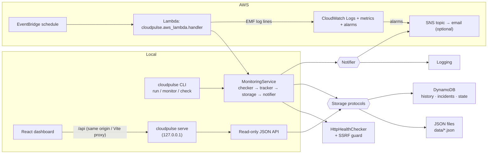

# CloudPulse

A cloud reliability and incident-response platform: CloudPulse checks HTTP(S)
endpoints on a schedule, opens an incident after repeated failures, detects
recovery, keeps history and state across restarts, sends notifications, and
shows everything in a small React dashboard.

It runs fully **locally** (JSON files, no AWS account needed) and has an
**AWS** backend (Lambda + EventBridge + DynamoDB + SNS + CloudWatch) defined in
Terraform.

> **Implementation status at a glance**
>
> | Area | Status |
> | --- | --- |
> | Monitoring engine, incidents, JSON storage, CLI, API, dashboard | Implemented and **tested locally** |
> | DynamoDB / SNS adapters, Lambda handler | Implemented and **tested against mocked AWS (moto)** |
> | Terraform | Written; **syntax-parsed locally only**. `terraform fmt -check` and `terraform validate` run in CI — Terraform was not installed on the development machine |
> | AWS deployment | **Not deployed.** No AWS resources have been created; there is no public endpoint |

> 📸 **Screenshot placeholder** — no screenshot is committed yet. Run the
> dashboard locally (see [Dashboard](#dashboard)), capture the overview page,
> save it as `docs/images/dashboard-overview.png` and replace this note with
> ``.

## Quick start: monitor a URL in 3 steps

No configuration files needed. In Windows PowerShell, from the project folder:

```powershell
# 1. One-time setup
py -3 -m venv .venv
.\.venv\Scripts\python.exe -m pip install -r requirements-dev.txt -e .
npm --prefix dashboard ci
npm --prefix dashboard run build

# 2. Start CloudPulse (dashboard + automatic checks every 60 s)
.\.venv\Scripts\python.exe -m cloudpulse serve --static dashboard/dist
```

3. Open **http://127.0.0.1:8000**, click **+ Add a URL**, type a name and a
   web address (for example `example.com`) and press **Add service**. For a
   web app keep **Full site (recommended for web apps)** selected — it also
   checks the app's files, pages and backend APIs.
   CloudPulse runs a first check immediately, then keeps checking it in the
   background while `serve` is running. Use **Check now** / **Check all now**
   at any time, and **Edit** / **Delete** to change your list.

## Contents

- [Quick start](#quick-start-monitor-a-url-in-3-steps)
- [Features](#features)
- [Architecture](#architecture)
- [Technology stack](#technology-stack)
- [Project structure](#project-structure)
- [Local setup (Windows PowerShell)](#local-setup-windows-powershell)
- [Configuration](#configuration)
- [CLI](#cli)
- [Running the tests](#running-the-tests)
- [Dashboard](#dashboard)
- [AWS architecture](#aws-architecture)
- [Deploying with Terraform](#deploying-with-terraform)
- [Cost and cleanup](#cost-and-cleanup)
- [Security](#security)
- [Troubleshooting](#troubleshooting)
- [Further documentation](#further-documentation)

## Features

- **Health checks** over HTTP/HTTPS with configurable timeout, accepted status
  range (default `200-399`) and redirect limit. Every result records service,
  UTC timestamp, status code, response time and a typed error
  (`DNS_ERROR`, `CONNECTION_ERROR`, `TIMEOUT`, `TLS_ERROR`, `HTTP_STATUS`,
  `INVALID_URL`, `BLOCKED_DESTINATION`, `REDIRECT_LIMIT`, `PROTOCOL_ERROR`,
  `UNEXPECTED_ERROR`).
- **Incident lifecycle** `OPEN → RECOVERED` with severities `LOW`, `MEDIUM`,
  `HIGH`, `CRITICAL`; opens only at the consecutive-failure threshold, never
  duplicates an active incident, resets the counter on success, optional
  escalation to `CRITICAL` after N failures.
- **Restart safe**: active incidents and failure counters are restored;
  missing, corrupt and inconsistent state is handled explicitly.
- **Concurrency safe**: optimistic versioning on monitoring state and
  conditional DynamoDB writes, plus a duplicate-invocation guard.
- **Notifications** on open / escalation / recovery only (not on every failed
  check) via logging and Amazon SNS; delivery failures never affect incident
  state.
- **Storage adapters** with one shared contract: in-memory, JSON files,
  DynamoDB (Query-based, GSIs, TTL, pagination).
- **CLI** for one-off checks, scheduled runs, status, incidents, history,
  serving the dashboard API, and config validation, with meaningful exit codes.
- **Manage services from the dashboard**: add, edit and delete URLs with a
  simple form (advanced settings collapsed), inline validation and friendly
  errors; **Check now** per service and **Check all now**.
- **Full-site checks** for web apps: from just the main URL, also checks
  the page's own files, a few pages and the backend APIs its JavaScript calls
  (discovered automatically), so a dead backend behind a working page is
  reported — naming the failing component in plain words.
- **Automatic background checks** inside `cloudpulse serve` (default every 60
  seconds), protected against double-running with `cloudpulse run --loop` by
  a shared lease.
- **One service list everywhere**: services added in the dashboard are stored
  through the storage abstraction (JSON locally, DynamoDB in AWS), so the CLI,
  the API and Lambda all see them. A services file is still supported.
- **JSON API** + **React/TypeScript dashboard** (overview, services,
  incidents with filters/sorting/pagination, service detail with response-time
  trend and recovery timeline). Write endpoints are local-only by default or
  require an admin token. A clearly labelled demo mode is opt-in.
- **SSRF protection**: loopback, private, link-local and metadata addresses
  are blocked after DNS resolution, on the connected socket, and after every
  redirect.

### Quick vs. full-site checks

| | Quick (this URL only) | Full site (recommended for web apps) |
| --- | --- | --- |
| Checks | the one address | the page, its own JS/CSS files, up to 10 same-site pages, up to 5 backend APIs found in its code |
| Catches | the URL being down | missing files, broken pages, **a dead or misconfigured backend behind a page that still loads** |
| Best for | APIs, `/health` endpoints | single-page apps on Firebase/Netlify/Vercel/S3 |

Static hosting answers `200` for the page even when the API behind it is
down, so a quick check of such a site says "Healthy" while the app is broken.
A full-site check reads the page's HTML and JavaScript bundles to find the
backend origins the app calls (e.g. `axios.create({baseURL: …})`,
`fetch("https://…")`, `VITE_API_URL`, `<link rel=preconnect>`), filters
third-party noise (fonts, CDNs, analytics, Google, docs links), and sends
**one GET to each backend's root**. Any answer below 500 — even 404/401/405 —
means the server is up; 5xx, timeouts, DNS/TLS/connection errors mean down.
If the app's own code points its API at `localhost` or a private address,
the backend is reported **down** ("visitors' browsers cannot reach it") — this
is a common production build mistake. Discovery is cached and refreshed every
6 hours, after a deploy changes the bundles, and on **Check now**; on the
service page (**What we check**) you can turn off a noisy component or add one
discovery missed.

**What a full-site check cannot catch:** features behind a login, actions
that fail while the server is up (e.g. a "Quick Add" whose AI provider
errors — CloudPulse only sends GET requests and never submits forms), and
backends whose address is only decided at runtime. For those, you can add a
`/health` endpoint to your backend that tests its own dependencies and add it
as a component (optional).

Safety and limits: every discovered URL passes the SSRF guard (DNS
resolution, connected peer, redirects); private/loopback/metadata targets are
never contacted. Requests are sequential, GET-only, with a polite
User-Agent, no cookies and no credentials. Caps per check: 10 pages, 30
assets, 5 backends, 10 manual components, 5 MB downloaded (2 MB per bundle),
90 seconds total. Backend timeout: 20 s by default (cold starts), 1–60 s.

### What "healthy" means

A check is healthy when, within the timeout, the endpoint returns a final
response (after at most `max_redirects` redirects, each re-validated) whose
status code is inside the service's `accepted_status` range (inclusive).
Everything else is unhealthy. "Recovered" means a later check was healthy;
CloudPulse never claims a root cause or that anything was fixed.

## Architecture



Details: [docs/architecture.md](docs/architecture.md).

## Technology stack

Python 3.12+ (tested on 3.13 and 3.14; standard library HTTP client, no
runtime dependencies except `boto3` for AWS) · pytest, moto, Ruff · AWS Lambda,
EventBridge, DynamoDB, SNS, CloudWatch · Terraform ≥ 1.10 · React 18 +
TypeScript + Vite, Vitest, Testing Library, ESLint · GitHub Actions.

## Project structure

```text
src/cloudpulse/
  health_check.py         HTTP checker, typed errors, guarded transport
  url_safety.py           URL validation and SSRF policy
  incident_manager.py     Incident model + per-service state machine
  state.py                Persisted per-service monitoring state
  monitor.py              MonitoringService (one service, one check)
  runner.py               Check many services, isolate failures, time budget
  storage.py              Storage protocols
  history.py, json_storage.py, incident_storage.py   in-memory/JSON adapters
  dynamodb_storage.py, dynamodb_incident_storage.py  DynamoDB adapters
  notifications.py        Notifier protocol, logging/SNS/composite notifiers
  config.py               Env + services-file configuration and validation
  service_store.py        Dashboard-managed services (memory, JSON, DynamoDB)
  service_registry.py     Merged service list (services file + store), validation
  scheduler.py            Check-now runner and the background scheduler (lease)
  site_check.py           Full-site checks: discovery, probing, site profiles
  factory.py              Wiring of backends
  aws_lambda.py           Lambda entry point
  api.py, api_server.py   Dashboard API (reads + protected writes) and server
  observability.py        JSON logs and CloudWatch EMF metrics
  cli.py                  Command-line interface
tests/                    pytest suite (unit, integration, mocked AWS)
dashboard/                React + TypeScript dashboard (Vite)
infra/terraform/          AWS infrastructure
docs/                     Architecture, plan, deployment, testing
.github/workflows/        CI (automatic) and deploy (manual only)
```

## Local setup (Windows PowerShell)

Requires Python 3.12+ (3.14 used during development) and, for the
dashboard, Node.js 22.12+ or 24.

```powershell
cd C:\path\to\cloudpulse
py -3 -m venv .venv
.\.venv\Scripts\Activate.ps1
python -m pip install --upgrade pip
python -m pip install -r requirements-dev.txt
python -m pip install -e .        # provides the `cloudpulse` command
cloudpulse --help
```

If script execution is blocked, run
`Set-ExecutionPolicy -Scope CurrentUser RemoteSigned` once, or call
`.\.venv\Scripts\python.exe -m cloudpulse` without activating.

## Configuration

Everything has a sensible default, so no configuration is needed to start.
Settings come from environment variables — see [.env.example](.env.example)
(placeholders only). CloudPulse does not read `.env` files itself; set
variables in your shell, e.g. `$env:CLOUDPULSE_CHECK_INTERVAL_SECONDS = "30"`.

### Where the list of services comes from

1. **The dashboard (recommended)** — services you add there are saved in
   `data/services.json` (local) or the DynamoDB services table (AWS). The
   CLI can manage the same list:
   `cloudpulse services add NAME URL`, `cloudpulse services list`,
   `cloudpulse services remove NAME`.
2. **A services file (optional, for automation)** — `CLOUDPULSE_SERVICES_FILE`
   (see [services.example.json](services.example.json)) or inline
   `CLOUDPULSE_SERVICES`. These services are shown in the dashboard as
   *read-only (services file)*. Run `cloudpulse services import` to copy them
   into the store so they can be edited in the dashboard (then remove the
   file setting).

| Variable | Default | Meaning |
| --- | --- | --- |
| `CLOUDPULSE_ENV` | `local` | `production` forbids private targets |
| `CLOUDPULSE_BACKEND` | `local` | `local` (JSON), `memory`, `aws` |
| `CLOUDPULSE_DATA_DIR` | `data` | JSON storage directory |
| `CLOUDPULSE_SERVICES_FILE` / `CLOUDPULSE_SERVICES` | — | service list (one of them) |
| `CLOUDPULSE_TIMEOUT_SECONDS` | `5` | default per-check timeout (max 30) |
| `CLOUDPULSE_FAILURE_THRESHOLD` | `3` | default failures before an incident |
| `CLOUDPULSE_MAX_REDIRECTS` | `5` | redirects followed (each re-validated) |
| `CLOUDPULSE_ALLOW_PRIVATE_TARGETS` | `false` | local testing only |
| `CLOUDPULSE_MIN_CHECK_INTERVAL_SECONDS` | `0` | skip duplicate checks |
| `CLOUDPULSE_CHECK_INTERVAL_SECONDS` | `60` | background checks in `serve` (min 10) |
| `CLOUDPULSE_ADMIN_TOKEN` | — | ≥ 32 chars; required for changes when set, and for `--allow-remote` |
| `CLOUDPULSE_LOG_LEVEL` | `INFO` | `DEBUG`…`ERROR` |
| `CLOUDPULSE_API_HOST` / `_PORT` | `127.0.0.1` / `8000` | local API |
| `CLOUDPULSE_CORS_ORIGINS` | Vite dev origins | explicit origins, no `*` |
| `AWS_REGION` | — | AWS backend region |
| `CLOUDPULSE_HEALTH_TABLE`, `_INCIDENTS_TABLE`, `_STATE_TABLE` | — | required for `aws` |
| `CLOUDPULSE_SERVICES_TABLE` | — | DynamoDB table for dashboard-managed services (aws) |
| `CLOUDPULSE_SNS_TOPIC_ARN` | — | SNS alerts (aws backend only) |
| `CLOUDPULSE_HISTORY_RETENTION_DAYS` | `30` | DynamoDB TTL for history |

Per-service options: `name` (required), `url`, `timeout_seconds`,
`failure_threshold`, `severity`, `accepted_status` (`[low, high]`),
`escalation_threshold`, `enabled`. Unknown keys are rejected; at most 50
services.

## CLI

```powershell
cloudpulse serve --static dashboard/dist         # dashboard + automatic checks
cloudpulse serve --check-interval 30 --scheduler on
cloudpulse services add my-shop https://shop.example.com/ --threshold 2 --full
cloudpulse check https://my-app.web.app/ --full   # one-off full-site check with a component table
cloudpulse services list
cloudpulse services remove my-shop
cloudpulse services import                        # copy services-file entries into the store
cloudpulse check https://example.com/            # one check, nothing stored
cloudpulse run                                    # check all services once
cloudpulse run --loop --interval 60               # keep checking (not while serve is checking)
cloudpulse run --service example-site --json
cloudpulse status                                 # current state per service
cloudpulse incidents --status OPEN --severity HIGH
cloudpulse history --service example-site --limit 20
cloudpulse config validate
cloudpulse https://example.com --threshold 3 --interval 10   # legacy continuous monitor
```

Global options: `--backend {local,memory,aws}`, `--services-file`,
`--data-dir`, `--allow-private`, `--log-level`.

Exit codes: `0` ok/healthy · `1` a check was unhealthy · `2` usage or
configuration error · `3` storage error or a service could not be processed ·
`130` interrupted.

To test against a local endpoint (e.g. `http://127.0.0.1:8080`) pass
`--allow-private` (refused when `CLOUDPULSE_ENV=production`).

`serve --scheduler auto` (default) runs background checks for the `local` and
`memory` backends and not for `aws`, where the scheduled Lambda checks. Only
one scheduler checks at a time: `serve` and `run --loop` share a lease, and a
second one waits (`run --loop` exits with a clear message).

## Running the tests

```powershell
.\.venv\Scripts\python.exe -m ruff check src tests
.\.venv\Scripts\python.exe -m ruff format --check src tests
.\.venv\Scripts\python.exe -m pytest
.\.venv\Scripts\python.exe -m pytest --cov
```

Results on the development machine (Windows 11, Python 3.14.0): **529
passed**, branch coverage **92 %**. Dashboard: **67 passed**. Tests never
contact AWS (moto mocks) and only use the network against servers they
start on `127.0.0.1`. See [docs/TESTING.md](docs/TESTING.md).

## Dashboard

Build once and serve the dashboard, API and background checks from one
process (see [Quick start](#quick-start-monitor-a-url-in-3-steps)):

```powershell
npm --prefix dashboard ci
npm --prefix dashboard run build
cloudpulse serve --static dashboard/dist          # http://127.0.0.1:8000
```

For frontend development, run `cloudpulse serve` in one terminal and
`npm --prefix dashboard run dev` (http://127.0.0.1:5173, proxies `/api`) in
another.

Pages:

- **Overview** — totals, open incidents, recent recoveries, recent checks,
  automatic-check status, **Check all now**. With no services it shows an
  *Add your first URL to monitor* call to action.
- **Add / Edit service** — name and URL, the check type (*Full site*, the
  default for new services, or *Quick*), plus a collapsed *Advanced settings*
  section (timeout, failures before an incident, severity, healthy status
  codes, backend timeout, enabled). Instant validation with friendly messages (bad URL,
  duplicate name, private/local address, 50-service limit); the server
  re-validates everything. A success notification confirms the result of the
  first check.
- **Services** — status, last check, response time, failures and current
  incident, with **Check now**, **Edit** and **Delete** (with confirmation).
- **Incidents** — status/severity filters, sortable columns, pagination.
- **Service detail** — actions, **What we check** (every component with
  its status and a plain-language problem, turn off/on, add a missed
  backend or page, and an honest list of what full checks cannot catch),
  check history, response-time trend, incident history and recovery
  timeline.

Loading, empty and error states are handled; the layout works on phones;
all times are shown in UTC.

**Demo mode** (`http://127.0.0.1:5173/?demo=1` or `VITE_DEMO_MODE=true`)
uses fabricated sample data and shows a permanent banner saying so. It is
never enabled implicitly.

The browser only talks to the CloudPulse API; it never holds AWS credentials.
To view and manage AWS data, run `cloudpulse serve --backend aws` locally with
your own credentials (set `CLOUDPULSE_SERVICES_TABLE` to manage services; the
Lambda picks them up on its next run). No hosted API or dashboard is deployed.

### Who can make changes

| Server setup | Reading | Adding/editing/deleting/checking |
| --- | --- | --- |
| Default (`127.0.0.1`, no token) | anyone who can reach localhost | only requests from this computer |
| `CLOUDPULSE_ADMIN_TOKEN` set | as above | only with `Authorization: Bearer <token>` (the dashboard asks for it and keeps it for the browser tab only) |
| `--allow-remote` | network clients | refused to start unless `CLOUDPULSE_ADMIN_TOKEN` is set |

Generate a token with
`python -c "import secrets; print(secrets.token_urlsafe(32))"`.

## AWS architecture

- **EventBridge** rule (`rate(5 minutes)` by default) invokes the Lambda;
  a resource policy allows only that rule.
- **Lambda** (`python3.13`, arm64) runs `cloudpulse.aws_lambda.handler`:
  loads and validates config, checks each service with a per-service time
  budget, isolates per-service failures, writes structured JSON logs and EMF
  metrics, and returns a summary. No retries for async invocations.
- **DynamoDB** (on-demand): `…-health-checks` (PK `service`, SK
  `checked_at#id`, TTL), `…-incidents` (PK `id`, GSIs
  `service-created-index` and `status-created-index`), `…-monitor-state`
  (PK `service`, versioned).
- **SNS** topic for incident notifications and alarms; optional email
  subscription (must be confirmed by the recipient — CloudPulse never assumes
  it is confirmed).
- **CloudWatch**: log group with retention, metrics `ChecksPerformed`,
  `ChecksFailed`, `IncidentsOpened`, `IncidentsEscalated`,
  `IncidentsRecovered`, `NotificationFailures`, `ServiceErrors`,
  `ServicesSkipped`; alarms for Lambda errors, duration, heartbeat, service
  errors and notification failures.
- **DynamoDB services table** (`…-services`, PK `name`) holds services added
  from the dashboard; the Lambda reads it (one-page `Scan`, ≤ 50 items) on
  every run in addition to `services_json`.
- **IAM**: the Lambda role can only write its own logs, use the monitoring
  tables (specific actions), read the services table and publish to the one
  topic; it also carries a permissions boundary.

Changing the schedule: set `schedule_expression` (e.g. `"rate(1 minute)"` or
`"cron(0/10 * * * ? *)"`) and keep `min_check_interval_seconds` below the
interval, then `terraform plan` / `apply`.

## Deploying with Terraform

Nothing in this repository has been deployed. Full instructions, IAM
prerequisites, state handling, SNS subscription and verification steps are in
[docs/DEPLOYMENT.md](docs/DEPLOYMENT.md). Short version:

```powershell
cd infra\terraform
Copy-Item terraform.tfvars.example terraform.tfvars   # edit placeholders
terraform init
terraform fmt -check
terraform validate
terraform plan -out tfplan        # review resources and cost first
terraform apply tfplan            # only when you are ready to pay for it
```

## Cost and cleanup

Designed for very low cost at hobby scale: on-demand DynamoDB, short Lambda
runs, no NAT gateway, VPC, API Gateway or KMS keys. Expect cents per month for
a handful of services at a 5-minute schedule, plus ~USD 0.10 per CloudWatch
alarm per month (5 alarms; disable with `enable_alarms = false`) and EMF
custom metrics (8 metrics, ~USD 0.30 each per month after the free tier).
Check current AWS pricing for your region — these are estimates, not
measurements.

Cleanup: `terraform destroy` in `infra/terraform` (review the plan first;
with `enable_deletion_protection = true` disable it first). Locally, delete
the `data/` directory to reset JSON storage.

## Security

Implemented:

- SSRF guard: scheme allow-list, no credentials in URLs, IP-literal check,
  DNS resolution check of **every** address, connect-to-validated-IP and
  connected-peer check (prevents DNS rebinding), redirect re-validation,
  environment proxies ignored. Private targets can be allowed for local
  testing only; `CLOUDPULSE_ENV=production` refuses that.
- Bounded work: per-check timeout (max 30 s per service, budget shared
  across redirects), max 5 redirects by default, response bodies never read,
  max 50 services, bounded API page sizes, bounded JSON history.
- No secrets in code; AWS credentials only via the standard chain. URLs are
  redacted (no user-info, query or fragment) in notifications, the API and
  stored history. Error messages for unexpected exceptions contain only the
  exception type.
- Service registration is protected: write endpoints are local-only by
  default (loopback client of a loopback-bound server) or require the admin
  token (constant-time comparison); `--allow-remote` requires a token.
  Cross-site writes are blocked (JSON content type, `Origin` check) and DNS
  rebinding is blocked (`Host` must be localhost). Request bodies are capped at
  16 KiB, writes are rate limited (60/min) and checks too (20/min) per client,
  and at most 50 services exist. Every URL is SSRF-checked when saved
  (including DNS resolution) and again on every check and redirect.
- Strict query and body validation, explicit CORS allow-list, security
  headers, binds to `127.0.0.1` by default.
- Least-privilege IAM with resource-scoped ARNs and a permissions boundary;
  the optional GitHub deploy role uses OIDC, is restricted to one repository
  and environment, and can only create roles carrying the boundary.
- Optimistic concurrency + conditional writes prevent duplicate incidents
  across concurrent or retried invocations.
- `npm audit`: 0 known vulnerabilities at the pinned versions (checked
  2026-10-19).

Known limitations:

- Reads (service names, redacted URLs, incidents) are not authenticated.
  Keep the server on `127.0.0.1`, or put `--allow-remote` behind your own
  access controls/TLS. There is a single admin token, not user accounts.
- The timeout is a socket timeout per operation plus a budget across
  redirects; a server that drips headers slowly can exceed it. The Lambda time
  budget still bounds each run.
- JSON storage is meant for one machine: writes are atomic, leases use a
  lock file, and Windows sharing violations are retried briefly.
- On Windows, connecting to a closed local port can surface as `TIMEOUT`
  rather than `CONNECTION_ERROR` because Windows retries refused connections.
- GitHub Actions are pinned to major version tags, not commit SHAs.

## Troubleshooting

| Symptom | Fix |
| --- | --- |
| `ModuleNotFoundError: cloudpulse` | `pip install -e .` or run pytest from the repo root (pytest is configured with `pythonpath = src`) |
| `configuration error: … blocked (non-public) address` | Target is loopback/private. For local testing use `--allow-private`; never in production |
| `No services configured yet` | Add one in the dashboard, with `cloudpulse services add NAME URL`, or set `CLOUDPULSE_SERVICES_FILE` |
| "…resolves to a blocked address" when adding | The address is on a private/local network; CloudPulse only monitors public addresses |
| No **+ Add service** button | The browser is not on the computer running CloudPulse, or the server is read-only (aws backend without `CLOUDPULSE_SERVICES_TABLE`) |
| `Another CloudPulse scheduler is already checking` | `cloudpulse serve` is already checking automatically; stop it or don't use `run --loop` |
| Dashboard asks for an admin token | The server has `CLOUDPULSE_ADMIN_TOKEN` set; ask whoever runs it |
| `storage error: … is not valid JSON` | The data file is corrupt. CloudPulse will not overwrite it — fix or move it |
| Dashboard shows "Cannot reach the CloudPulse API" | Start `cloudpulse serve` (port 8000) before `npm run dev` |
| `The aws backend requires: …` | Set the three `CLOUDPULSE_*_TABLE` variables (Terraform outputs them) |
| No alert emails | Confirm the SNS subscription email; check spam |

## Further documentation

- [docs/architecture.md](docs/architecture.md) — components, data model, state machine
- [docs/IMPLEMENTATION_PLAN.md](docs/IMPLEMENTATION_PLAN.md) — audit, bugs fixed, phases
- [docs/DEPLOYMENT.md](docs/DEPLOYMENT.md) — AWS deployment and teardown
- [docs/TESTING.md](docs/TESTING.md) — test strategy and results
