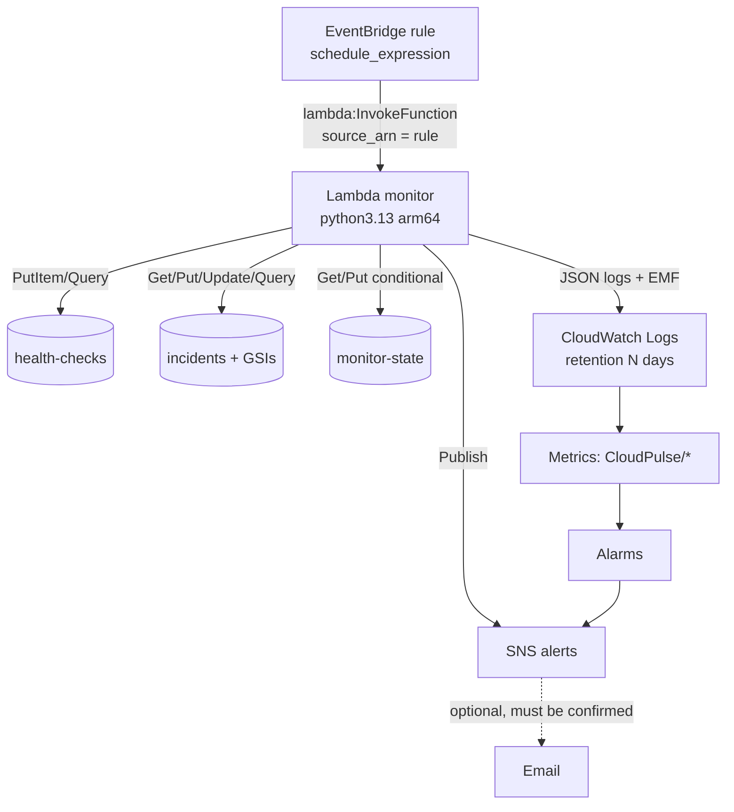

# CloudPulse — Architecture

This document describes what is implemented in the repository. Where
something is only planned or not deployed, it says so.

## 1. Purpose

CloudPulse monitors HTTP(S) endpoints, detects repeated failures, opens
incidents, detects recovery, persists history and state, notifies people, and
presents the data in a dashboard. Core logic is plain Python with no cloud
dependencies; AWS services are adapters around it.

## 2. Components

| Layer | Module(s) | Responsibility |
| --- | --- | --- |
| URL safety | `url_safety.py` | Syntax/scheme validation, SSRF policy, URL redaction |
| Checker | `health_check.py` | Guarded HTTP transport, redirects, timeouts, typed errors |
| State machine | `incident_manager.py`, `state.py` | Incident model, transitions, serialization, persisted state |
| Orchestration | `monitor.py`, `runner.py` | One check per service; many services with isolation and time budget |
| Storage | `storage.py` + adapters | Protocols; in-memory, JSON, DynamoDB implementations |
| Notifications | `notifications.py` | Message formatting; logging, SNS, composite notifiers |
| Configuration | `config.py`, `factory.py` | Env/services-file validation; backend wiring |
| Service list | `service_store.py`, `service_registry.py` | Dashboard-managed services (memory/JSON/DynamoDB) merged with services-file entries; field-level validation and SSRF pre-check |
| Full-site checks | `site_check.py` | HTML/JS discovery of assets, pages and backend origins; bounded, SSRF-guarded GET probes; per-component results; cached site profile with user overrides |
| Scheduling | `scheduler.py` | "Check now" runner (one run at a time per process) and the background scheduler of `serve`, guarded by a storage lease |
| Entry points | `cli.py`, `aws_lambda.py`, `api_server.py` | CLI, Lambda handler, local HTTP server |
| API | `api.py` | Read-only JSON views for the dashboard |
| Observability | `observability.py` | JSON logs, CloudWatch EMF metrics |
| Dashboard | `dashboard/` | React + TypeScript single-page app |
| Infrastructure | `infra/terraform/` | DynamoDB, Lambda, IAM, EventBridge, SNS, CloudWatch |

All collaborators of `MonitoringService` are injected: checker (HTTP
client), history storage, incident/state storage, notifier and clock. Tests
use a fixed clock and scripted checkers/transports.

## 3. Check flow

```mermaid
sequenceDiagram
    participant S as Scheduler (CLI loop / EventBridge)
    participant M as MonitoringService
    participant C as HttpHealthChecker
    participant H as History storage
    participant T as Incident tracker
    participant I as Incident + state storage
    participant N as Notifier
    S->>M: run()
    M->>M: skip if checked < min interval ago (duplicate guard)
    M->>C: check(url, timeout, accepted_status)
    C-->>M: result {checked_at, is_healthy, status_code, response_time_ms, error_type}
    M->>H: add(result)  (failure is reported, not fatal)
    M->>T: evaluate(result) -> Transition
    M->>I: save_state(version check)  (conflict => reload, abort)
    M->>I: add/update incident
    M->>N: send(event)  (only OPENED / ESCALATED / RECOVERED; failures captured)
```

State is saved **before** the incident record so that, if two workers race,
only the one whose versioned state write succeeds goes on to create an
incident. Notifications are sent **last**, so a delivery failure cannot roll
back or corrupt stored incident state.

## 4. Incident state machine

```text
             failure (n < threshold)            failure (n = threshold)
HEALTHY ──────────────────────────> FAILING ───────────────────────────> OPEN
   ^             success               │                                  │ failure
   └───────────────────────────────────┘                                  ├──> ONGOING
   ^                                                                      │ failure (n = escalation_threshold)
   │                     success                                          ├──> ESCALATED (severity -> CRITICAL, once)
   └────────────────────────────────────── RECOVERED <───────────────────┘
```

`ServiceIncidentTracker.evaluate()` returns one of `NONE`,
`FAILURE_RECORDED`, `INCIDENT_OPENED`, `INCIDENT_ONGOING`,
`INCIDENT_ESCALATED`, `INCIDENT_RECOVERED`. At most one incident per service
is active.

Incident fields: `id`, `service_name`, `service_url`, `severity`, `status`,
`created_at`, `updated_at`, `recovered_at`, `duration_seconds`,
`failure_count`, `first_failure_at`, `last_failure_at`, `last_error`,
`last_error_type`, `last_status_code`, `escalated_at`, `diagnostics`
(threshold, error-type counts, escalation source). All timestamps are
ISO-8601 UTC with offset; naive timestamps are rejected.

### Restart and inconsistency handling

On start-up `MonitoringService` loads the service state and all OPEN
incidents for the service:

| Situation | Handling |
| --- | --- |
| No state | Start with zero failures |
| Open incident exists | Restored as the active incident; counter restored |
| Several open incidents | Newest is active; a warning is recorded; all are recovered together on the next healthy check |
| State points to a missing/closed incident | Reference cleared, counter kept (next failure reopens immediately), warning recorded |
| Corrupt JSON / invalid record | `StorageCorruptError` with a clear message; the file is never overwritten |
| Incident write failed earlier | Next failure re-creates the record from memory |

## 5. Storage

Protocols (`storage.py`): `HealthCheckStorage` (`add`, `get_recent`,
`get_all`, `count`) and `IncidentStorage` (`add`, `get`, `get_all`,
`list_incidents`, `update`, `get_open_incident(s)`, `get_state`,
`save_state`, `get_failure_count`, `save_failure_count`, `count`). One shared
contract test suite runs against the in-memory, JSON and DynamoDB (moto)
adapters.

### JSON (local)

`data/health_checks.json`, `data/incidents.json`,
`data/incidents_state.json`. Atomic writes (temp file + `os.replace`),
bounded history (10 000 records), legacy `{service: count}` state format is
read and upgraded. Single-process use.

### DynamoDB (AWS)

| Table | Key | Indexes / TTL | Access patterns |
| --- | --- | --- | --- |
| `<prefix>-health-checks` | PK `service`, SK `sk` = `checked_at#id` | TTL `expires_at` | Recent checks per service: one `Query`, newest first |
| `<prefix>-incidents` | PK `id` | GSI `service-created-index` (`service_name`, `created_at`); GSI `status-created-index` (`status`, `created_at`) | Incidents per service; recent OPEN / RECOVERED incidents; by id |
| `<prefix>-monitor-state` | PK `service` | — | Get/put state with `version` condition |

- No production path scans: listing uses the GSIs; `get_all()`/`count()` are
  administrative and paginate.
- Creation uses `attribute_not_exists(id)`; updates use `UpdateItem` with
  `attribute_exists(id)` (no read-modify-write); state saves require the
  stored `version` to match.
- Floats are stored as `Decimal` and converted back on read.
- `status-created-index` has only two partition values. That is fine at this
  scale; for very high incident volumes, shard the key (e.g. by month).

### Services

| Store | Location | Notes |
| --- | --- | --- |
| JSON | `data/services.json` | `{name: record}`, atomic writes |
| DynamoDB | `<prefix>-services`, PK `name` | conditional create/replace; listing is a one-page `Scan` (≤ 50 items) |

`ServiceRegistry` merges *config* services (services file / `CLOUDPULSE_SERVICES`,
read-only through the API) with *dashboard* services from the store; a name
defined in both uses the config entry. The CLI, the API, the background
scheduler and the Lambda all read services through the registry.

### Site profiles (full-site checks)

Per service, `get_site_profile` / `save_site_profile` keep: discovered
backend origins, discovery time and bundle fingerprint (rediscover after 6 h,
on a new bundle set, or on "Check now"), the user's manual components and
turned-off URLs, and the last component snapshot shown under *What we check*.
Stored as `__site__:<name>` in the JSON state file or as a state-table item
in DynamoDB. History records only keep `component_counts` and up to five
`failed_components`, so history stays small.

Full check flow: main page (body ≤ 2 MB) → parse HTML (`<script src>`,
stylesheets, `modulepreload`, `preconnect`, `<a href>`, inline scripts) →
probe own assets (re-read every check, so new hashed bundles never cause
false alarms) and, when discovery is due, scan bundles (≤ 2 MB each, ≤ 5 MB
total) → probe up to 10 pages → GET each backend origin root. Healthy only if
the main page, assets, pages and every enabled backend are up. A discovered
backend on a private/loopback address is never contacted and counts as down
(`PRIVATE_BACKEND`): on a public site, visitors cannot reach it.

### Leases (no double-running)

`IncidentStorage.acquire_lease(name, owner, ttl, now)` /
`release_lease(name, owner)` give an exclusive, expiring lease:

- JSON: entry `__lease__:<name>` in `incidents_state.json`, updated under an
  exclusive lock file (cross-process) and a thread lock.
- DynamoDB: item `service = "__lease__:<name>"` in the state table, written
  with `attribute_not_exists OR owner = me OR lease_expires_at < now`.

`cloudpulse serve` (background scheduler) and `cloudpulse run --loop` both
take the `scheduler` lease before each round. Lambda does not use it; it
relies on the per-service minimum-interval guard and versioned state, which
also protect against any stray extra run.

## 6. Notifications

`Notifier.send(NotificationEvent)`. Implementations: `LoggingNotifier`,
`SnsNotifier` (subject ≤ 100 ASCII chars, message attributes `event_type`,
`severity`, `service`), `CompositeNotifier`, `RecordingNotifier` (tests).
SNS is only wired for the `aws` backend, so local runs never publish real
notifications. Messages contain redacted URLs and classified errors only.

## 7. AWS runtime



Handler behaviour (`aws_lambda.py`): validates config (`CLOUDPULSE_BACKEND=aws`
required), accepts EventBridge scheduled events or `{"services": [...]}`,
rejects other shapes, reuses AWS clients on warm starts, skips services that
cannot finish before the Lambda deadline, records per-service failures,
raises (so the Errors alarm fires) only when every service failed, and emits
EMF metrics with a single `Environment` dimension.

Status: **implemented and tested with moto; not deployed.**

## 8. Dashboard and API

The dashboard calls `/api/*` on the same origin (Vite proxy in development,
`cloudpulse serve --static` otherwise).

Read routes: `GET /api/health` (capabilities: `can_write`, `can_check`,
`auth_required`, scheduler status, limits, form defaults), `/api/overview`,
`/api/services`, `/api/services/{name}`, `/api/services/{name}/checks`,
`/api/incidents`, `/api/incidents/{id}`.

Write routes: `POST /api/services`, `PUT /api/services/{name}`,
`DELETE /api/services/{name}`, `POST /api/services/{name}/check`,
`POST /api/checks`. Errors use `{"error", "message", "field"?}` with
`400` (validation, includes the offending `field`), `401` (token required),
`403` (not allowed / cross-site), `404`, `405`, `409` (services-file entry is
read-only), `411`/`413`/`415` (body), `421` (bad `Host`), `429` (rate limit,
`Retry-After`), `503` (storage/checks unavailable).

Permission is decided by the HTTP layer (`api_server.py`): without an admin
token only loopback clients of a loopback-bound server may write; with
`CLOUDPULSE_ADMIN_TOKEN` every write needs `Authorization: Bearer <token>`
(constant-time comparison); `--allow-remote` requires the token. Writes also
require a same-origin/allowed `Origin`, JSON bodies ≤ 16 KiB and pass per-client
rate limits. Demo mode is opt-in, labelled and read-only. No hosted deployment
exists.

## 9. Security design

See the README "Security" section for the full list and known limitations.
Key points: SSRF guard with DNS + connected-peer validation and redirect
re-validation; bounded timeouts/redirects/page sizes; no response bodies;
redaction of URLs; least-privilege IAM with a permissions boundary; OIDC for
CI deploys; read-only, localhost-bound API.
